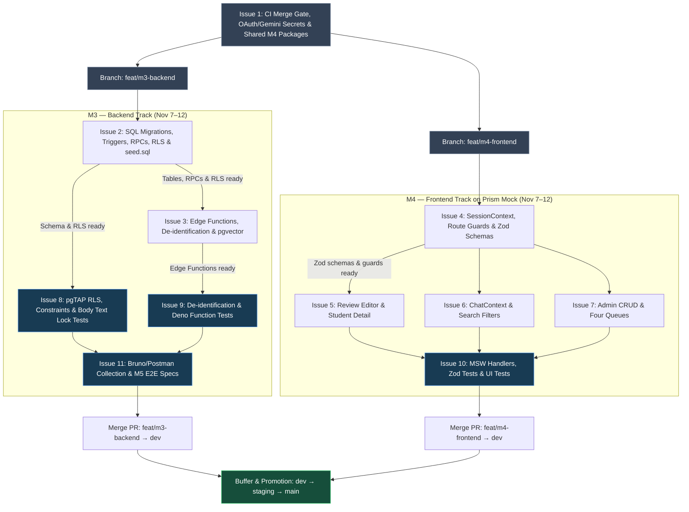

# SPMIS: Student Profiling Management Information System
## Minutes of the Meeting #12

* **Date:** 07 November 2026
* **Meeting:** Eleventh Weekly Project Meeting for SPMIS
* **Time:** 9:10 PM to 9:24 PM
* **Platform:** Discord
* **Attendance:** 10 of 11 members present (Quorum met)
* **Absentees:** Liza Mae Caduyac

---

### I. CALL TO ORDER
The eleventh weekly project meeting was called to order at 9:10 through Discord. Ten of the eleven members were present, meeting the required quorum.

### II. AGENDA AND DISCUSSION

#### 1. Milestone 2 Pull Request Status
The team discussed the current status of the Milestone 2 Pull Request (PR) and its readiness for finalization:
* The Milestone 2 PR was confirmed to be completed and submitted.
* The team was awaiting review and feedback to determine whether additional changes or revisions would be required.

#### 2. Development Workflow Formalization
The team discussed and formalized the development and review workflow for the upcoming milestones, including branching conventions, task dependencies, and the distribution of contributions.

The following arrangements were discussed:
* **Milestone Branching:** Each milestone will maintain its own development branch. Upon completion, a Pull Request will be submitted from the milestone branch to `dev` for review by the instructors, rather than directly to `staging`. This workflow will apply to Milestones 3, 4, and 5.
* **Concurrent Development:** The next development priorities are Milestone 3 (Backend) and Milestone 4 (Frontend). The corresponding GitHub Issues have already been prepared, and both milestones will be developed concurrently.
* **Task Dependencies:** The development workflow will follow the sequence illustrated in the presented branching diagram. Tasks positioned earlier in the workflow must be completed before dependent tasks can proceed. For the detailed milestone branching workflow and task dependency diagram, refer to the Markdown version of Minutes of the Meeting No. 12 (`mom-12.md`).

**Milestone Branching and Task Dependency Diagram**

* **Individual Contributions:** The team discussed balancing the number of commits made by individual members to maintain a fair distribution of project contributions.

#### 3. Development Reminder and Project Timeline
The team was reminded of the established development conventions, documentation requirements, and upcoming project deadlines.
* **Commit Conventions:** All commits must follow the Conventional Commits format to maintain consistency across the repository.
* **GitHub Templates:** Members must use the established templates in the `.github` directory when preparing Pull Requests, task issues, bug reports, and other relevant documentation.
* **Milestone Deadlines:** Milestones 2 and 3 are targeted for completion by November 14 or 15, 2026, while Milestone 5 is expected to be completed before November 27, 2026.
* **Development Freeze:** Beginning November 25, 2026, regular feature development must stop, with only bug fixes permitted.
* **Deployment Schedule:** Deployment is scheduled for November 27, 2026.
* **Final Presentation:** The project presentation is scheduled for December 3, 2026.
* **Development Resumption:** Development will resume immediately upon approval of the Milestone 2 Pull Request.

### III. DECISION MADE
* The completed Milestone 2 Pull Request will await review and approval before further development proceeds.
* Milestones 3, 4, and 5 will follow the established milestone-branch workflow, with Pull Requests submitted to `dev` for instructor review rather than directly to `staging`.
* Milestone 3 (Backend) and Milestone 4 (Frontend) will be developed concurrently, following the established task dependencies.
* Individual commit contributions will be balanced among members to support fair distribution of project work.
* Members must follow Conventional Commits and use the prescribed GitHub templates for project submissions.
* The development freeze will begin on November 25, 2026, limiting subsequent work to bug fixes.
* Deployment is scheduled for November 27, 2026, followed by the project presentation on December 3, 2026.

### IV. ACTION ITEMS

| Action Item | Responsible Member(s) | Status |
| :--- | :--- | :--- |
| Await review and approval of the completed Milestone 2 Pull Request and address any required revisions | Assigned Milestone 2 Members | Pending |
| Begin concurrent development of Milestone 3 and Milestone 4 following Milestone 2 approval | Backend and Frontend Teams | Pending |
| Follow the approved milestone branching workflow and task dependencies | All Members | For Compliance |
| Follow Conventional Commits and use the established GitHub templates | All Members | For Compliance |
| Complete remaining milestone deliverables within the established deadlines | Assigned Development Teams | Pending |

**Note:** "Pending" status indicates the task is yet to be initiated.

### V. ADJOURNMENT
The meeting was concluded at 9:24 following discussions on the Milestone 2 Pull Request status, the formalized development and branching workflow, concurrent Milestone 3 and 4 development, individual commit contributions, repository conventions, and the upcoming project deadlines.

### VI. SIGNATORIES
*(Signatures not available in markdown format; please refer to the original PDF)*

**Prepared by:**  
Geryme M. Vega  
*Secretary, SPMIS*  

**Noted by:**  
Norman John Bandibas  
*Team Leader, SPMIS*